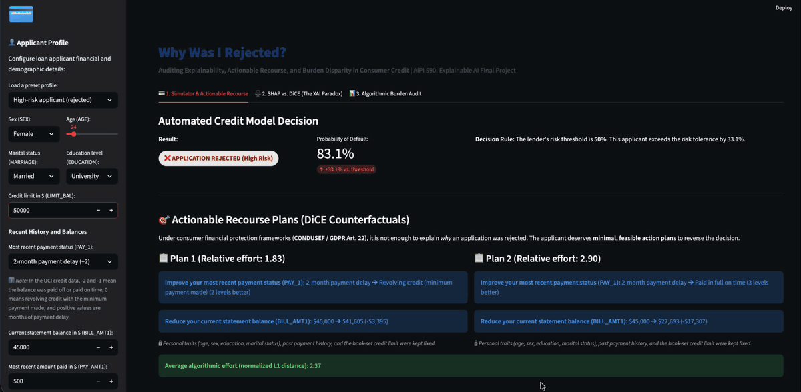
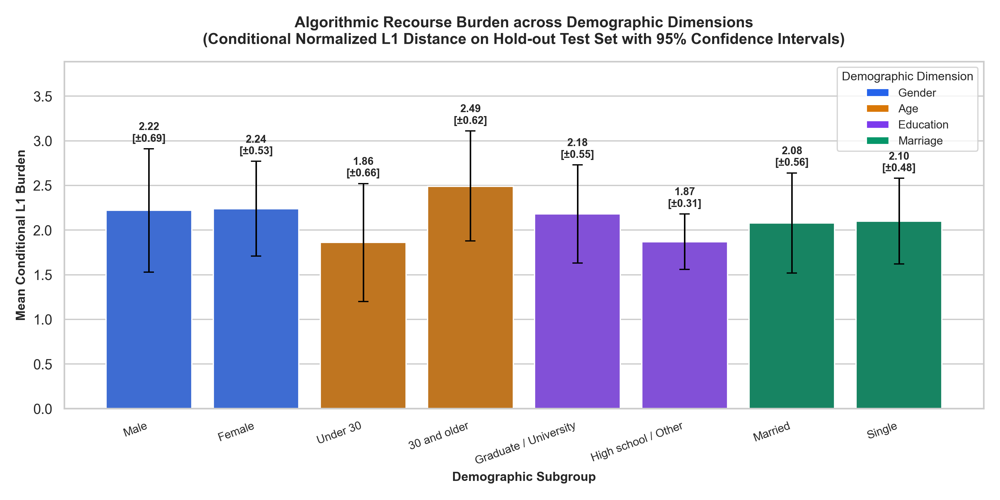

# Why Was I Rejected?
### Actionable Credit Recourse and a Fairness Audit for People Outside the Traditional Banking System

**Author:** Tonantzin Real Rojas · **Course:** AIPI 590 – Explainable AI, Duke University

When a credit model rejects someone, the usual explanation (e.g. SHAP) says *why*: "your payment history and balance raised your risk." That is useful to the lender, but it does not tell the applicant **what to do next**. This project builds a customer-facing tool that answers the question every rejected applicant actually has: ***what can I change, today, to get approved?*** It then audits whether that path to approval is equally available to everyone.

The project has three parts:
1. **A credit model and two kinds of explanations:** SHAP (why you were rejected) and DiCE counterfactual recourse (what to change), with strict rules so the tool only recommends changes a person can actually make.
2. **An interactive web app** (Streamlit) where you can enter an applicant profile and see the decision, the explanations, and concrete, plain-language action plans.
3. **A fairness audit** of all 1,749 rejected applicants in the test set, comparing who gets a plan and how much effort it requires, across sex, age, education, and marital status.

---

## 🎬 Demo

Selecting different applicant profiles in the app: the decision, the plain-language action plans, SHAP vs. DiCE, and the fairness audit.



📄 **Poster (36" × 24"):** [poster/poster.pdf](poster/poster.pdf)

---

## 📊 Results at a Glance

| Question | Finding |
|---|---|
| **Does SHAP tell rejected applicants what they can change?** | Mostly no. **68%** of SHAP's top-3 reasons for a rejection are things the applicant cannot change today (past payment history 55%, bank-set credit limit 12.5%, demographics 1%). For **49.5%** of applicants the #1 reason is not actionable, and **27.7%** get no actionable reason at all. |
| **Can we give realistic, actionable plans instead?** | Yes, for **47.2%** of rejected applicants (825 of 1,749), using only three things a person controls: payment status, statement balance, and payment amount. The rules are enforced on every plan: it never worsens payment status, never increases debt, and never raises a payment above the bill. |
| **Is the path to approval equally available to all groups?** | **Effort is equal:** among people who get a plan, no group needs significantly more effort (all Holm-adjusted p = 1.0). **Access is not:** a plan exists significantly less often for applicants **30 and older** (44.2% vs. 53.2% for under 30, p_adj = 0.002) and **married** applicants (43.8% vs. 50.3% for single, p_adj = 0.021). No significant gaps by sex or education. |



---

## 🇲🇽 Motivation: Financial Inclusion in Mexico

This project is designed **from the customer's perspective**, not the lender's. The intended setting is a Mexican financial institution serving people who are new to, or excluded from, formal credit:

- Only **53%** of Mexican adults have an account at a financial institution or mobile-money provider (2024), compared with **73.5%** across Latin America & the Caribbean (2021) — *World Bank Global Findex*.
- Only about **37%** of adults aged 18–70 hold any formal credit (≈39% of men, 36.1% of women) — *INEGI/CNBV, ENIF 2024*. Coverage also varies widely by region: 84.9% of people in the northeast have at least one financial product, versus 67.7% in the south.
- Only **15%** of adults borrowed formally; distrust, **excessive requirements**, and **limited financial education** are cited as the main barriers — *Global Findex 2025, as reported by El Financiero*.
- **61%** of Mexican adults score below the minimum desirable level of financial knowledge (Mexico 12.2 vs. G20 average 12.7) — *BBVA Research, 2019 (OECD/INFE methodology)*.
- When asked why people do not take credit, INEGI and CNBV officials noted the answers suggest *"tal vez se necesite una mayor educación financiera"* ("perhaps more financial education is needed") — *ENIF 2024 press conference*.

People outside the traditional banking system are the least likely to know what lenders look for. A tool that turns a rejection into a concrete, achievable plan addresses both barriers above: opaque requirements and limited financial education. **This repository is the first version (proof of concept):** it uses public data to build and evaluate the method before adapting it to Mexican data and a real institution (see [Future Work](#-future-work)).

---

## 🔬 Research Questions

1. **Explainability gap:** How actionable are SHAP's retrospective explanations for rejected applicants, compared with prescriptive counterfactual recourse (DiCE)?
2. **Actionability:** Can recourse be restricted to changes a person can actually make today, while locking demographics, past history, and lender-set limits?
3. **Fairness of recourse:** Do some demographic groups (a) need more effort to reach approval, or (b) get a feasible plan less often?

---

## 🖥️ The App

| Tab | What it shows |
|---|---|
| **1. Simulator & Actionable Recourse** | Enter a profile (or pick a preset). See the decision, the probability of default, and up to two action plans in plain language, e.g. *"Reduce your current statement balance (BILL_AMT1): $50,000 ➔ $13,245 (-$36,755)"*. |
| **2. SHAP vs. DiCE** | Side-by-side comparison of SHAP's "why" (with readable feature names) and DiCE's "what to do", plus the measured actionability of SHAP's reasons across all rejected applicants. |
| **3. Fairness Audit** | A one-line key finding, a summary table per demographic dimension, overall metrics, the burden chart, and conclusions with regulatory recommendations. (Full statistical test details are in `models/audit_disparity_results.json` and the notebook.) |

---

## ⚙️ How It Works and Key Design Decisions

**Data.** [UCI Default of Credit Card Clients](https://archive.ics.uci.edu/dataset/350/default+of+credit+card+clients) (Yeh & Lien, 2009): 30,000 credit card holders in **Taiwan**, April–September 2005, 23 features (credit limit, demographics, 6 months of payment status, bills, and payments). It is downloaded automatically from OpenML (ID 42477) and cleaned in `src/data_loader.py` (undocumented education and marital codes are merged into "Other"). Split: 80% train / 20% test, stratified.

**Model.** LightGBM with balanced class weights (the default rate is ~22%). A tree ensemble was chosen because it is strong on tabular data and supports exact TreeSHAP. Test-set performance: **ROC-AUC 0.779**, accuracy 0.764, precision 0.474, recall 0.625, F1 0.539. An applicant is **rejected when P(default) ≥ 0.50**, which rejects 29.1% of the test set. *Design note: this dataset records defaults, not lending decisions, so "rejection" is simulated as a high predicted default risk.*

**What a plan may change (actionability rules).** This is the core design decision. Each feature is classified by whether a person can change it *today*:

| Category | Features | Rule |
|---|---|---|
| Actionable | `PAY_1` (latest payment status), `BILL_AMT1` (current balance), `PAY_AMT1` (latest payment) | May change, in one direction only (below) |
| Immutable | `SEX`, `AGE`, `EDUCATION`, `MARRIAGE` | Locked: a plan must never ask someone to change who they are |
| Historical | `PAY_2–6`, `BILL_AMT2–6`, `PAY_AMT2–6` | Locked: the past cannot be rewritten |
| Institutional | `LIMIT_BAL` (credit limit) | Locked: set by the lender, not the applicant |

Direction rules: payment status can only stay the same or improve; the balance can only go down; the payment can only stay the same or go up, and an increased payment cannot exceed the plan's own balance.

**Recourse engine (DiCE).** Plans are generated with DiCE's model-agnostic random search (Mothilal et al., 2020) over a 2,000-row background sample. For each applicant, DiCE proposes a pool of 10 candidate plans; plans that break the rules are discarded and the lowest-effort valid plan is kept. All runs are seeded for reproducibility.

**Measuring effort (algorithmic burden).** Effort is the total size of the changes, with each change divided by that feature's standard deviation so that dollars and status codes are comparable (normalized L1 distance, following the burden notion of Sharma et al., 2020).

**Fairness audit design.** Every model-rejected test applicant (1,749) gets one plan search; results are reused across four comparisons: female vs. male, under 30 vs. 30 and older, high school/other vs. graduate/university, single vs. married. Two separate questions are tested for each comparison:
- **Feasibility** (does a plan exist?): Fisher's exact test.
- **Effort** among applicants with a plan: Welch's t-test (Mann–Whitney U also reported), with 95% confidence intervals.

Effort is only defined for people who get a plan, so feasibility is tested separately to avoid survivorship bias. p-values are corrected for multiple comparisons with Holm–Bonferroni (within each family of 4 tests and globally across all 8).

**SHAP actionability audit.** For every rejected test applicant, the top-3 features that *increase* default risk according to TreeSHAP are classified with the categories above (`src/xai_shap.py`).

---

## 📁 Repository Structure

```
app/main.py                 Streamlit web app (3 tabs)
src/data_loader.py          Download, cleaning, train/test split, feature categories
src/train_model.py          Trains and evaluates the LightGBM model; saves model + metadata
src/xai_shap.py             SHAP explanations + SHAP actionability audit
src/xai_recourse.py         DiCE recourse engine with actionability rules
src/audit.py                Fairness audit with statistical tests; saves JSON + chart
notebooks/01_...ipynb       End-to-end report: data → model → SHAP → DiCE → audit → conclusions
models/                     Trained model, metadata, and all results (JSON + chart)
data/                       Created automatically on first run (dataset cache, not in git)
docs/demo.gif               App demo recording
poster/                     Print poster (PDF) and the script that builds it from the results (python poster/build_poster.py --pdf)
```

---

## 🚀 Setup and Running

**Requirements:** Python 3.12 (tested), internet access on first run (the dataset is downloaded from OpenML, ~2.7 MB).

```bash
git clone https://github.com/tonantzin-real/AIPI_590_Project_1.git
cd AIPI_590_Project_1
pip install -r requirements.txt
```

**Just explore the app** (the trained model and audit results are included):
```bash
streamlit run app/main.py
```
It opens at http://localhost:8501. The first launch downloads the dataset automatically (up to a minute, depending on your connection).

**Reproduce everything from scratch** (run from the project root):

| Step | Command | Time | Output |
|---|---|---|---|
| 1. Train the model | `python src/train_model.py` | ~1 min | `models/credit_model.joblib`, `models/model_metadata.json` |
| 2. SHAP actionability audit | `python src/xai_shap.py` | ~10 s | `models/shap_actionability_results.json` |
| 3. Fairness audit | `python src/audit.py` | ~15–20 min | `models/audit_disparity_results.json`, `models/audit_disparity_plot.png` |
| 4. Launch the app | `streamlit run app/main.py` | — | Web app |

For a quick audit check on a sample (~5 min): `python -c "from src.audit import run_demographic_recourse_audit as r; r(sample_per_group=80)"` (this overwrites the full results; re-run step 3 afterwards).

---

## ⚠️ Limitations

**Data**
- **Not Mexican data.** The data comes from Taiwan in 2005. Customer behavior, products, regulation, and the meaning of each feature may differ from Mexico today, so the findings do not transfer directly.
- **Currency.** Amounts are in New Taiwan dollars; the app shows them with a generic "$", not Mexican pesos.
- **Default is not a lending decision.** The label is whether a card holder defaulted the next month. "Rejection" is simulated with a 0.5 default-risk threshold; real underwriting uses more information and policies.
- **Few levers.** Only three features can change. Real applicants could also change income, savings, employment, or products held, none of which are in this dataset.
- **Simplified app input.** The app asks for the most recent month only and fills in the previous five months with a fixed pattern.

**Method**
- **One model, one threshold.** Results may change with a different model or cut-off. Predicted probabilities are not calibrated.
- **No causal model.** Changes are treated as independent; for example, a larger payment does not automatically lower next month's balance. Only a simple consistency rule is enforced.
- **Effort is statistical, not real cost.** Burden is measured in standard deviations, not in money, time, or difficulty for a specific person. Paying $15,000 is not equally hard for everyone.
- **"No plan found" is not proof that no plan exists.** DiCE uses a random search with a fixed budget, so feasibility depends partly on the search.
- **Plans are not guarantees.** A plan is valid for this model only; if the lender retrains or changes its policy, the plan may no longer lead to approval.
- **Demographics are model inputs.** They are locked in the plans but still influence the decision itself.

**Fairness audit**
- **Dimensions are tested one at a time.** Age and marital status are correlated (younger applicants are more often single), so the two significant gaps may be the same effect; intersectional groups were not analyzed.
- **Coarse categories.** Sex is recorded as binary in the data, and education and marital codes are merged.
- **Test set only.** The audit covers 1,749 rejected applicants; smaller real-world groups would have less statistical power.
- **SHAP audit scope.** It covers the top-3 risk-increasing features per applicant; SHAP explains the model, not real-world causes.

---

## 🛡️ Risks, Stakeholders, and Deployment Considerations

**Stakeholders.** Applicants, especially first-time and underserved borrowers (primary audience); lenders, who must stand behind the recommendations; regulators such as CONDUSEF and CNBV in Mexico; and communities with low financial inclusion.

**Risks and possible misuse**
- **Harmful plans.** A plan such as "pay $15,000 this month" could push someone toward informal, high-interest borrowing. A deployed tool needs affordability checks based on income.
- **False hope.** Users may read a plan as a promise of approval. The interface must say clearly that plans are guidance, not guarantees.
- **Gaming.** Knowing exactly what flips a decision could encourage misreporting. This is less of a concern for verified data such as payment records.
- **Fairwashing.** Offering explanations can make an unfair model look legitimate. The fairness audit should accompany any deployment, not be optional.
- **Privacy.** Plans reveal how sensitive financial data drives a decision; they should only be shown to the applicant.

**Deploying in Mexico would require:** retraining on Mexican data with peso amounts; a Spanish-language, mobile-friendly interface for users with low financial literacy; review against CONDUSEF consumer-protection rules; re-running the fairness audit regularly and whenever the model changes; and keeping plans valid across model updates.

---

## 🔭 Future Work

This is **version 1**, a proof of concept. Next steps:
1. **Mexican data:** partner with a Mexican financial institution, or use ENIF data, to retrain and re-audit the model in pesos.
2. **More realistic levers:** income, savings, employment, and time-based plans (e.g., "pay X for the next 3 months").
3. **Causal recourse:** model how actions affect each other (Karimi et al., 2022) so plans stay consistent over time.
4. **Affordability-aware plans:** limit recommendations to what the person can realistically pay.
5. **Intersectional audit:** test combined groups (e.g., married applicants over 30) and separate the age and marital-status effects.
6. **User study:** test with Mexican users outside the traditional banking system whether plans are understandable and useful.
7. **Spanish-language version** of the app for real users.
8. **Robust recourse:** plans that remain valid when the model is retrained.

---

## 📚 References

**Explainability and algorithmic recourse**
- Wachter, S., Mittelstadt, B., & Russell, C. (2017). Counterfactual explanations without opening the black box: Automated decisions and the GDPR. *Harvard Journal of Law & Technology, 31*(2).
- Ustun, B., Spangher, A., & Liu, Y. (2019). Actionable recourse in linear classification. *Proceedings of FAT\* 2019*.
- Mothilal, R. K., Sharma, A., & Tan, C. (2020). Explaining machine learning classifiers through diverse counterfactual explanations. *Proceedings of FAT\* 2020*. ([DiCE](https://github.com/interpretml/DiCE))
- Karimi, A.-H., Barthe, G., Schölkopf, B., & Valera, I. (2022). A survey of algorithmic recourse: Contrastive explanations and consequential recommendations. *ACM Computing Surveys, 55*(5).
- Barocas, S., Selbst, A. D., & Raghavan, M. (2020). The hidden assumptions behind counterfactual explanations and principal reasons. *Proceedings of FAT\* 2020*.
- Lundberg, S. M., & Lee, S.-I. (2017). A unified approach to interpreting model predictions. *NeurIPS 2017*.
- Lundberg, S. M., et al. (2020). From local explanations to global understanding with explainable AI for trees. *Nature Machine Intelligence, 2*, 56–67.

**Fairness of recourse**
- Sharma, S., Henderson, J., & Ghosh, J. (2020). CERTIFAI: A common framework to provide explanations and analyse the fairness and robustness of black-box models. *Proceedings of AIES 2020*.
- Gupta, V., Nokhiz, P., Roy, C. D., & Venkatasubramanian, S. (2019). Equalizing recourse across groups. *arXiv:1909.03166*.
- von Kügelgen, J., Karimi, A.-H., Bhatt, U., Valera, I., Weller, A., & Schölkopf, B. (2022). On the fairness of causal algorithmic recourse. *AAAI 2022*.

**Data, model, and statistics**
- Yeh, I.-C., & Lien, C.-H. (2009). The comparisons of data mining techniques for the predictive accuracy of probability of default of credit card clients. *Expert Systems with Applications, 36*(2), 2473–2480.
- Ke, G., et al. (2017). LightGBM: A highly efficient gradient boosting decision tree. *NeurIPS 2017*.
- Holm, S. (1979). A simple sequentially rejective multiple test procedure. *Scandinavian Journal of Statistics, 6*(2), 65–70.

**Financial inclusion in Mexico**
- INEGI & CNBV (2025). [*Encuesta Nacional de Inclusión Financiera (ENIF) 2024*](https://www.inegi.org.mx/contenidos/saladeprensa/boletines/2025/enif/ENIF2024_CP.pdf), results and [press conference transcript](https://www.inegi.org.mx/contenidos/saladeprensa/boletines/2025/enif/VerEsten_ENIF2024.docx).
- World Bank (2025). Global Findex Database: [account ownership, Mexico](https://api.worldbank.org/v2/country/MEX/indicator/FX.OWN.TOTL.ZS?format=json).
- Garza, J. (2025, October 16). [Inclusión financiera en México, conectividad sin confianza](https://www.elfinanciero.com.mx/monterrey/2025/10/16/jesus-garza-inclusion-financiera-en-mexico-conectividad-sin-confianza/). *El Financiero*.
- BBVA Research (2019). [61% of Mexicans below the minimum desirable financial knowledge score](https://www.bbvaresearch.com/en/publicaciones/61-of-mexicans-below-the-minimum-desirable-financial-knowledge-score/).
